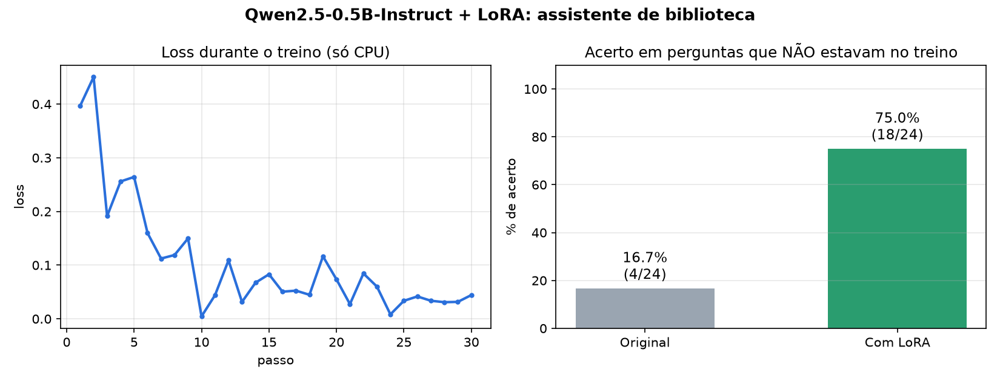

# Fine-tuning de um Qwen com LoRA, numa CPU sem placa de vídeo

Projeto de estudo: ensinar um modelo de linguagem pequeno a **indicar a tela certa de um sistema de biblioteca** a partir de um pedido em português, como faria um assistente de atendimento.

Exemplo: *"O leitor veio entregar o livro que pegou semana passada"* → **Abra a tela Devolução de livros.**

O treino foi feito **de verdade, num PC comum** (AMD Ryzen 5 5600GT, 32 GB de RAM, **sem GPU dedicada**), e levou cerca de **9 minutos**.



## Resultado

Avaliação em **24 perguntas que não entraram no treino**:

| Modelo | Acertos | Taxa de acerto |
|---|---|---|
| Qwen2.5-0.5B-Instruct original | 4/24 | 16,7% |
| Qwen2.5-0.5B-Instruct + LoRA | 18/24 | **75,0%** |

Os dois modelos recebem **o mesmo prompt**, com a lista das 12 telas. A diferença está só no treino.

Mesmo com a lista na mão, o modelo original errava quase tudo e chegava a **inventar telas que não existem**, como "Consulta de multas". Depois do ajuste, ele passa a seguir o vocabulário do sistema.

A tabela resposta a resposta está em [resultados/comparacao.md](resultados/comparacao.md).

### O que ainda erra (e por quê)

Os 6 erros que sobraram estão nas telas mais "vizinhas" entre si:

- "avisar quando o livro voltar" (Reserva) foi confundido com Consulta de empréstimos;
- "quitar o que deve" (Multas) foi confundido com Devolução;
- "lista de quem está com livro vencido" (Relatório de atrasos) foi confundido com Consulta de empréstimos.

Com só 74 exemplos de treino, isso é esperado. O próximo passo natural seria mais exemplos dessas telas, e não ajustar o modelo olhando para o teste.

## O que a IA aprendeu, em palavras simples

Imagine uma biblioteca com um sistema de **12 telas**. Um funcionário novo não sabe qual tela abrir para cada situação.

A IA foi treinada para fazer o papel de **colega experiente**: a pessoa descreve a situação do jeito dela, por exemplo *"O leitor trouxe o livro de volta"*, e a IA responde sempre no mesmo formato: **"Abra a tela Devolução de livros."**

Para ensinar, ela viu **74 exemplos** de pergunta com a tela certa (o treino). Depois, para ver se aprendeu de verdade e não só decorou, recebeu **24 perguntas novas** que nunca tinha visto (o teste).

<details>
<summary><b>As 74 perguntas do treino</b> (clique para abrir)</summary>

**Cadastro de livros**
- Quero cadastrar um livro novo.
- Chegou uma doação de livros, onde registro eles?
- Comprei 20 exemplares novos para o acervo.
- Preciso corrigir o ISBN de um livro.
- Como mudo a editora de um livro já cadastrado?
- Onde informo o número de páginas e o ano de publicação de uma obra?
- Quero dar baixa em um livro que foi danificado e descartado.

**Cadastro de autores**
- Preciso incluir um novo autor no catálogo.
- O nome da autora está escrito errado, onde corrijo?
- Onde adiciono a biografia de um escritor?
- Preciso registrar o pseudônimo de um autor.
- Quero colocar a nacionalidade de um escritor.
- Tem dois autores duplicados, quero juntar os dois.

**Cadastro de leitores**
- Quero inscrever um novo sócio.
- Um aluno novo quer fazer a carteirinha da biblioteca.
- Preciso alterar o endereço de um leitor.
- O telefone de um usuário mudou.
- Onde atualizo o e-mail de uma pessoa cadastrada?
- Preciso bloquear o cadastro de um leitor que se mudou da cidade.

**Consulta de leitores**
- Quero procurar um usuário pelo nome.
- Como encontro um leitor pelo CPF?
- Qual é o número da carteirinha da Maria Souza?
- Preciso ver os dados de contato de um leitor.
- Quero listar todos os leitores do bairro Centro.
- Será que essa pessoa já tem cadastro aqui?

**Catálogo do acervo**
- Vocês têm o livro Dom Casmurro?
- Tem algum livro sobre Python disponível?
- Quais livros de Machado de Assis existem na biblioteca?
- Quero buscar livros de ficção científica.
- Quero pesquisar um título pelo ISBN.
- Em qual estante fica o livro de Cálculo?

**Empréstimo de livros**
- Onde faço um novo empréstimo?
- Um leitor quer levar um livro para casa.
- Preciso registrar a saída de um livro para um aluno.
- Quero emprestar três livros para o mesmo leitor.
- O professor vai retirar uns livros hoje.
- Quero renovar o prazo de um livro que o leitor já pegou.

**Devolução de livros**
- Quero registrar a devolução de um livro.
- O leitor trouxe o livro de volta.
- A aluna veio entregar o livro que pegou semana passada.
- Deixaram dois livros na caixa de devolução.
- Como dou entrada no retorno de um exemplar?
- Preciso receber os livros que voltaram hoje.

**Consulta de empréstimos**
- Quero ver quais livros estão emprestados.
- Com quem está o livro O Cortiço agora?
- Qual é a data de devolução do livro que a Ana pegou?
- Quantos livros o João está com ele?
- Quero ver o histórico de empréstimos de um leitor.
- Preciso conferir os empréstimos feitos ontem.

**Reserva de livros**
- Um aluno quer reservar um livro que só volta semana que vem.
- O livro está emprestado, o leitor quer entrar na fila de espera.
- Quero guardar um livro para um leitor que vem buscar amanhã.
- Preciso cancelar uma reserva.
- Onde vejo as reservas em aberto?
- Quem está na fila para pegar Harry Potter?

**Cobrança de multas**
- O leitor quer pagar a multa por atraso.
- Quanto o Pedro está devendo para a biblioteca?
- Preciso perdoar a multa de um leitor.
- Quero emitir o recibo de pagamento de uma multa.
- Qual o valor da taxa por dia de atraso que esse leitor deve?
- Um livro foi perdido e o leitor vai pagar por ele.

**Relatório de empréstimos em atraso**
- Preciso consultar os empréstimos em atraso.
- Quero a lista de livros que passaram do prazo.
- Quantos empréstimos estão vencidos este mês?
- Vou ligar para quem não devolveu no prazo, preciso da lista.
- Quero imprimir os atrasos para mandar para a diretoria.
- Me mostra todos os livros que deveriam ter voltado e não voltaram.

**Relatório de livros por categoria**
- Quero saber quantos livros existem por categoria.
- Quantos livros de romance nós temos ao todo?
- Qual gênero tem mais livros no acervo?
- A diretoria pediu o total de obras de cada categoria.
- Preciso de um gráfico do acervo dividido por assunto.
- Quero exportar a contagem de títulos por área do conhecimento.

</details>

### As 24 perguntas do teste, que a IA nunca viu

| Pergunta | Tela certa | Modelo ajustado |
|---|---|---|
| Acabaram de chegar livros novos que a escola comprou. | Cadastro de livros | ✔ |
| O título de um livro foi cadastrado com erro de digitação. | Cadastro de livros | ✔ |
| Quero cadastrar a escritora Clarice Lispector no sistema. | Cadastro de autores | ✔ |
| Falta a data de nascimento de um autor. | Cadastro de autores | ✔ |
| Uma moça nova no bairro quer se tornar leitora da biblioteca. | Cadastro de leitores | ✔ |
| O leitor casou e mudou o sobrenome. | Cadastro de leitores | ✔ |
| Esse aluno é leitor da biblioteca? | Consulta de leitores | ✔ |
| Preciso achar o cadastro de um leitor pelo telefone. | Consulta de leitores | ✔ |
| Onde fica o livro O Pequeno Príncipe? | Catálogo do acervo | ✔ |
| Tem algum livro de receitas aqui? | Catálogo do acervo | ✔ |
| A Júlia quer levar dois livros emprestados. | Empréstimo de livros | ✔ |
| Vou liberar um livro para um leitor agora. | Empréstimo de livros | ✔ |
| O menino está devolvendo o gibi. | Devolução de livros | ✔ |
| Recebi de volta o livro de História. | Devolução de livros | ✘ disse Empréstimo de livros |
| Quero saber quem pegou o livro de Física. | Consulta de empréstimos | ✔ |
| Quais livros a professora Carla está com ela agora? | Consulta de empréstimos | ✔ |
| Uma leitora quer ser avisada quando o livro voltar. | Reserva de livros | ✘ disse Consulta de empréstimos |
| Quero segurar o último exemplar para um professor. | Reserva de livros | ✘ disse Empréstimo de livros |
| Quanto custa a multa desse aluno? | Cobrança de multas | ✔ |
| O leitor veio quitar o que deve. | Cobrança de multas | ✘ disse Devolução de livros |
| Quero mandar e-mail para todo mundo que está com livro vencido. | Relatório de empréstimos em atraso | ✘ disse Reserva de livros |
| Um usuário quer saber quais leitores têm livros atrasados. | Relatório de empréstimos em atraso | ✘ disse Consulta de empréstimos |
| Quantos livros de poesia temos comparado com os de suspense? | Relatório de livros por categoria | ✔ |
| Quero um resumo do acervo separado por tema. | Relatório de livros por categoria | ✔ |

**18 acertos em 24 (75%)**, contra 4 acertos antes do treino. Os erros ficaram entre telas parecidas (devolver × emprestar, reservar × consultar, atraso × consulta), o mesmo tipo de confusão que um funcionário novo teria.

## Como funciona

> Quer entender o treino por baixo dos panos, com o código explicado linha por linha? Veja o PDF [docs/como-a-ia-foi-treinada.pdf](docs/como-a-ia-foi-treinada.pdf).

| Conceito | O que é aqui |
|---|---|
| **Fine-tuning** | adaptar um modelo já treinado a uma tarefa específica |
| **LoRA** | congela os ~494 milhões de pesos originais e treina só pequenas matrizes extras: **8,8 milhões de parâmetros (1,75%)** |
| **SFT** (ajuste supervisionado) | cada exemplo é uma conversa: pergunta do usuário → resposta desejada |
| **Máscara de loss** | o erro só é calculado nos tokens da resposta, então o modelo aprende a responder e não a repetir a pergunta |

Configuração usada: LoRA `r=16`, `alpha=32`, em todas as projeções de atenção e MLP; 3 épocas, lote 8, `lr=2e-4`, 30 passos, float32 na CPU.

O resultado é um **adaptador de 34 MB** que se encaixa no modelo original. Ele não é uma cópia de 1 GB do modelo.

## Estrutura

```
dados/
  telas.json          12 telas do sistema fictício
  treino.jsonl        74 exemplos (pergunta -> tela)
  teste.jsonl         24 perguntas separadas, nunca vistas no treino
scripts/
  comum.py            prompt, carregamento do modelo e correção das respostas
  treinar.py          treino LoRA com laço PyTorch simples (sem Trainer)
  avaliar.py          taxa de acerto antes/depois e tabela comparativa
  perguntar.py        faz uma pergunta livre ao modelo
  grafico.py          gera resultados/resultado.png
colab/
  qlora_qwen3b_colab.ipynb   versão QLoRA (4 bits) com Qwen2.5-3B para GPU no Google Colab
resultados/           logs do treino, avaliações e gráfico
```

## Como rodar

Precisa só do [uv](https://docs.astral.sh/uv/). Ele instala o Python 3.12 e o PyTorch para CPU.

```bash
uv sync
uv run python scripts/avaliar.py              # 1. mede o modelo original
uv run python scripts/treinar.py              # 2. treina o adaptador (~9 min numa CPU de 6 núcleos)
uv run python scripts/avaliar.py --lora       # 3. mede o modelo ajustado
uv run python scripts/avaliar.py --comparar   # 4. gera resultados/comparacao.md
uv run python scripts/perguntar.py "O leitor quer pagar a multa"
```

O adaptador treinado também está disponível na aba **Releases** do repositório. Descompacte em `saida/adaptador-lora/` para pular o treino.

## E o Qwen 3B com QLoRA?

**QLoRA** é LoRA com o modelo base carregado em **4 bits**, o que reduz muito a memória de **GPU**. Numa CPU isso não ajuda, porque a quantização em 4 bits depende de CUDA.

Por isso, o projeto tem dois caminhos:

- **CPU (o que foi executado):** Qwen2.5-**0.5B** + LoRA em float32;
- **GPU (notebook pronto, não executado por mim):** Qwen2.5-**3B** + QLoRA com [Unsloth](https://github.com/unslothai/unsloth) no Google Colab, usando os mesmos dados e a mesma avaliação. Abra `colab/qlora_qwen3b_colab.ipynb` no Colab com GPU ativada.

## Limitações honestas

- Os dados são **sintéticos e poucos** (74 de treino e 24 de teste). O objetivo é aprender o fluxo, não ter um produto.
- 24 perguntas de teste é uma amostra pequena: cada pergunta vale 4,2 pontos percentuais.
- A correção é automática: conta como acerto se a **primeira tela citada** na resposta for a esperada.

## Licença

MIT
